# How it works: code map

Which files do what, which library each one uses, and how the code actually uses it. Every section has a diagram of real files, a walkthrough with code copied from the repo, and where to start when you change that part. Paths are from the repo root.

Contents:
1. [The big picture](#1-the-big-picture)
2. [Backend app and routing (FastAPI)](#2-backend-app-and-routing-fastapi)
3. [Database (SQLAlchemy)](#3-database-sqlalchemy)
4. [Migrations (Alembic)](#4-migrations-alembic)
5. [Request and response shapes (Pydantic)](#5-request-and-response-shapes-pydantic)
6. [Log-in (Authlib, PyJWT)](#6-log-in-authlib-pyjwt)
7. [Services and templates](#7-services-and-templates)
8. [Frontend app and routing (Vite, React Router)](#8-frontend-app-and-routing-vite-react-router)
9. [Talking to the API (openapi-typescript, openapi-fetch, TanStack Query)](#9-talking-to-the-api-openapi-typescript-openapi-fetch-tanstack-query)
10. [UI and theme (Mantine)](#10-ui-and-theme-mantine)
11. [Widgets (registry, react-grid-layout, aggregate)](#11-widgets-registry-react-grid-layout-aggregate)
12. [Tooling, CI and deploy](#12-tooling-ci-and-deploy)

---

## 1. The big picture
One request, end to end: a React component asks a hook for data, the hook calls the typed API client, the backend router checks who you are, queries the database through SQLAlchemy, and Pydantic shapes the answer.

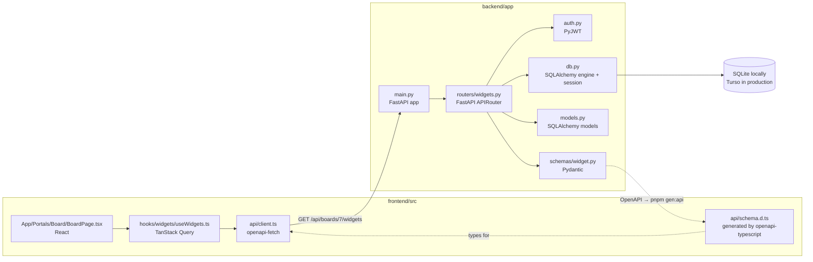

---

## 2. Backend app and routing (FastAPI)
**Library:** FastAPI (with Starlette underneath). **Files:** `backend/app/main.py`, `backend/app/routers/*.py`, `backend/app/db.py`, `backend/app/auth.py`.

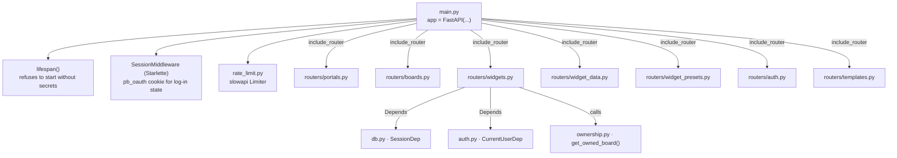

**How it does it**

`main.py` builds the app and plugs every router in. Each router is an `APIRouter` with a URL prefix:

```python
# backend/app/main.py
app = FastAPI(title="portal-boards", lifespan=lifespan)
app.include_router(portals.router)
app.include_router(widgets.router_board)
app.include_router(widgets.router_widget)
```

```python
# backend/app/routers/widgets.py
router_board = APIRouter(prefix="/api/boards/{board_id}/widgets", tags=["widgets"])
```

A route is a plain function. FastAPI reads its parameters and fills them in:
- `board_id: int` comes from the URL and is converted to an int (a 422 if it isn't one).
- `data: WidgetCreate` is the JSON body, validated by Pydantic.
- `session: SessionDep` and `user: CurrentUserDep` are **dependencies**: FastAPI calls a function and passes in what it returns.

```python
@router_board.get("")
def list_widgets(board_id: int, session: SessionDep, user: CurrentUserDep) -> list[WidgetRead]:
    board = get_owned_board(session, user, board_id)
    ...
```

The dependencies are `Annotated` types, so any route can ask for them by type:

```python
# backend/app/db.py
def get_session() -> Iterator[Session]:
    with Session(engine) as session:   # opened for this request, closed after it
        yield session

SessionDep = Annotated[Session, Depends(get_session)]
```

The return type (`-> list[WidgetRead]`) tells FastAPI how to turn the result into JSON and how to describe it in the OpenAPI spec at `/openapi.json` (browse it at `http://localhost:8000/docs`).

**Ownership checks** are ordinary functions that raise `HTTPException`. They all live in `ownership.py`, so routers never import from each other. Another user's board gets a 404, not a 403, so ids can't be probed:

```python
# backend/app/ownership.py
def get_owned_board(session: Session, user: User, board_id: int) -> Board:
    board = session.scalar(
        select(Board).join(Portal).where(Board.id == board_id, Portal.owner_id == user.id)
    )
    if board is None:
        raise HTTPException(status.HTTP_404_NOT_FOUND, "Board not found")
    return board
```

**Start here:** a new endpoint goes in the router for its resource. A new router also needs an `include_router` line in `main.py`. A helper that more than one router needs goes in `ownership.py` (ownership checks) or a service, never in a router.

---

## 3. Database (SQLAlchemy)
**Library:** SQLAlchemy 2.0 (the ORM), plus `sqlalchemy-libsql` for Turso. **Files:** `backend/app/models.py` (tables), `backend/app/db.py` (connection), and every router and service that queries.

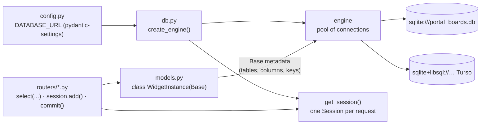

**How it does it**

*Models become tables.* Each class in `models.py` inherits from `Base` (a `DeclarativeBase`). `__tablename__` names the table, and every `Mapped[...]` attribute is a column. The Python type decides the column type and whether it can be null:

```python
# backend/app/models.py
class WidgetInstance(Base):
    __tablename__ = "widget_instances"

    id: Mapped[int] = mapped_column(primary_key=True)
    board_id: Mapped[int] = mapped_column(ForeignKey("boards.id", ondelete="CASCADE"), index=True)
    type: Mapped[str]                       # NOT NULL text
    template_key: Mapped[str | None]        # nullable text
    config: Mapped[dict[str, Any]] = mapped_column(default=lambda: {})   # JSON
    created_at: Mapped[datetime] = mapped_column(default=utcnow)
```

`Base` sets two project-wide rules: a `type_annotation_map` (so `dict[str, Any]` means a JSON column and `datetime` means the custom `UTCDateTime` type, which keeps times in UTC because SQLite has no time zones), and a naming convention for indexes and keys, so migrations can find them by name.

*The engine connects.* `db.py` reads `DATABASE_URL` and creates one engine for the app. The same code works for local SQLite and production Turso; only the URL and connect arguments differ. A `connect` event turns on SQLite's foreign keys, which are off by default and needed for `ON DELETE CASCADE`:

```python
# backend/app/db.py
if url.startswith("sqlite+libsql"):
    connect_args["auth_token"] = settings.turso_auth_token.get_secret_value()

@event.listens_for(engine, "connect")
def _enable_foreign_keys(dbapi_connection, connection_record) -> None:
    cursor = dbapi_connection.cursor()
    cursor.execute("PRAGMA foreign_keys=ON")
```

*Reading: a query is built in Python and run by the session.* `select()` builds the query, and the session turns it into SQL, runs it and turns rows back into model objects:

```python
statement = (
    select(WidgetInstance)
    .where(WidgetInstance.board_id == board.id)
    .order_by(WidgetInstance.y, WidgetInstance.x)
)
widgets = session.scalars(statement)        # SELECT … FROM widget_instances WHERE board_id = ? ORDER BY y, x
```

- `session.scalars(...)` gives many objects, and `session.scalar(...)` gives one (or `None`).
- `session.get(Portal, portal_id)` looks one up by primary key.
- `session.execute(...)` returns plain rows, for when you select columns instead of whole objects (`data_widget_ids` in `routers/widget_presets.py` does this).
- Joins are written out with `.join(Board)`; SQLAlchemy works out the `ON` from the foreign key. The models don't use `relationship()`.

*Writing: change objects, then commit.*

```python
widget = WidgetInstance(board_id=board.id, type=spec.type, x=0, y=..., w=spec.w, h=spec.h, config=config)
session.add(widget)       # INSERT is queued
session.commit()          # sent to the database, in one transaction
session.refresh(widget)   # reload it, so widget.id and created_at are filled in
```

Updating is just setting attributes and committing (`portal.name = data.name; session.commit()`). Deleting is `session.delete(obj)`. `session.flush()` sends pending changes without committing, used when the next insert needs an id (as in `create_portal`).

**Start here:** a new column goes in `models.py`, followed by a migration (next section). A new query goes in the router or service that needs it.

---

## 4. Migrations (Alembic)
**Library:** Alembic. **Files:** `backend/alembic.ini`, `backend/alembic/env.py`, `backend/alembic/versions/*.py`, `.github/workflows/migrate.yml`.

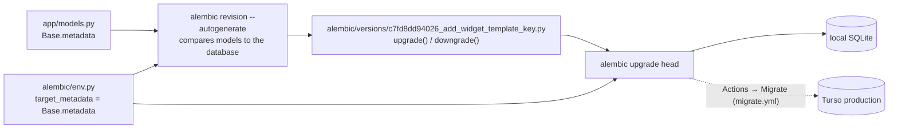

**How it does it**

`env.py` tells Alembic where the models are and how to connect. It reuses the app's settings and engine factory, so it migrates whatever `DATABASE_URL` points at:

```python
# backend/alembic/env.py
from app.db import create_db_engine
from app.models import Base

target_metadata = Base.metadata          # what the tables should look like
...
context.configure(connection=connection, target_metadata=target_metadata, render_as_batch=True)
```

`render_as_batch=True` is for SQLite, which can't change most columns in place: Alembic copies the table instead. That's also why migrations use an engine without the foreign-keys listener; with it, the copy would cascade-delete child rows.

`--autogenerate` diffs `Base.metadata` against the database and writes the difference as code. Each file points at the one before it, which makes a chain:

```python
# backend/alembic/versions/c7fd8dd94026_add_widget_template_key.py
revision = "c7fd8dd94026"
down_revision = "450e446edd92"

def upgrade() -> None:
    with op.batch_alter_table("widget_instances", schema=None) as batch_op:
        batch_op.add_column(sa.Column("template_key", sa.String(), nullable=True))

def downgrade() -> None:
    with op.batch_alter_table("widget_instances", schema=None) as batch_op:
        batch_op.drop_column("template_key")
```

The database stores its current revision in an `alembic_version` table, so `upgrade head` only runs the files it hasn't had. `alembic.ini` runs Ruff on every new file (the "found 6 errors, fixed 6" message).

CI runs `alembic upgrade head` then `alembic check`, which fails if the models changed without a migration. Production is migrated by hand: Actions → Migrate.

**Start here:** after changing `models.py`, run `uv run alembic revision --autogenerate -m "..."` in `backend`, read the file it wrote, then `uv run alembic upgrade head`.

---

## 5. Request and response shapes (Pydantic)
**Library:** Pydantic v2 (and `pydantic-settings` for config). **Files:** `backend/app/schemas/*.py`, `backend/app/config.py`, and on the frontend `frontend/src/api/schema.d.ts`.

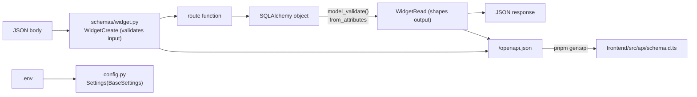

**How it does it**

A schema is a class of typed fields. FastAPI validates the request body against it and returns a 422 listing every problem if it doesn't fit:

```python
# backend/app/schemas/widget.py
class WidgetCreate(BaseModel):
    type: WidgetType                                  # must be one of the enum's values
    x: int | None = Field(default=None, ge=0)         # optional, and not negative
    w: int = Field(ge=1)
    config: dict[str, Any] = Field(default_factory=dict)
```

Read schemas turn database objects into JSON. `from_attributes=True` lets Pydantic read the SQLAlchemy object's attributes directly:

```python
class WidgetRead(BaseModel):
    model_config = ConfigDict(from_attributes=True)
    id: int
    board_id: int
    type: WidgetType
    config: dict[str, Any]
    created_at: datetime

return WidgetRead.model_validate(widget)
```

Keeping read schemas separate from models controls what leaves the server: a model column that isn't in the schema is never sent.

`config.py` uses the same idea for settings. `BaseSettings` fills each field from an environment variable or `backend/.env`, and `SecretStr` keeps secrets out of logs:

```python
class Settings(BaseSettings):
    model_config = SettingsConfigDict(env_file=BACKEND_DIR / ".env", extra="ignore")
    database_url: str = f"sqlite:///{(BACKEND_DIR / 'portal_boards.db').as_posix()}"
    jwt_secret: SecretStr = SecretStr("")
```

**Start here:** a new request or response shape goes in `schemas/`, exported from `schemas/__init__.py`. Then run `pnpm gen:api` (backend running) so the frontend sees it.

---

## 6. Log-in (Authlib, PyJWT)
**Libraries:** Authlib (OAuth with GitHub and Google), PyJWT (the session token), Starlette's `SessionMiddleware`, slowapi (rate limits). **Files:** `backend/app/oauth.py`, `backend/app/routers/auth.py`, `backend/app/auth.py`, `backend/app/services/users_service.py`, and on the frontend `src/components/RequireAuth.tsx`, `src/hooks/useCurrentUser.ts`, `src/api/client.ts`.

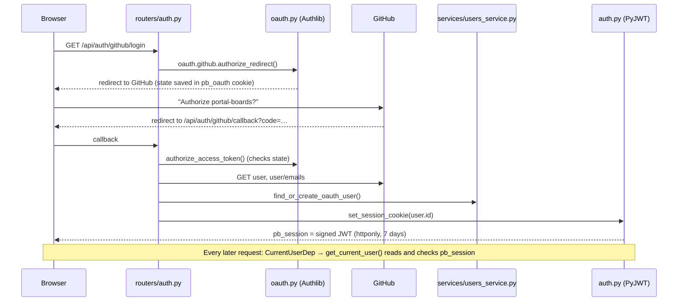

**How it does it**

`oauth.py` registers each provider with Authlib once:

```python
oauth.register(
    name="github",
    client_id=settings.github_client_id,
    client_secret=settings.github_client_secret.get_secret_value(),
    authorize_url="https://github.com/login/oauth/authorize",
    access_token_url="https://github.com/login/oauth/access_token",
    api_base_url="https://api.github.com/",
    client_kwargs={"scope": "read:user user:email"},
)
```

The login route sends the browser to GitHub, and the callback trades the code for a token. Authlib keeps the anti-forgery `state` in the `pb_oauth` cookie, which `SessionMiddleware` signs (set up in `main.py`).

`users_service.find_or_create_oauth_user` finds the user by provider account, then by **verified** email (so a second provider links to the same person), or creates one.

`auth.py` signs a JWT with `JWT_SECRET` and stores it in an httponly cookie the browser's JavaScript can't read:

```python
payload = {"sub": str(user_id), "iat": now, "exp": now + timedelta(days=7)}
jwt.encode(payload, require_secret(get_settings().jwt_secret, "JWT_SECRET"), algorithm="HS256")
```

`get_current_user` is the dependency behind `CurrentUserDep`. It reads the cookie, checks the signature and expiry, loads the user, and refreshes the cookie once a day so active users stay logged in. A missing or bad cookie is a 401.

On the frontend, `useCurrentUser` calls `GET /api/users/me`, and `RequireAuth` wraps private routes: a loader while it's pending, a redirect to `/log-in` with no user. `api/client.ts` also redirects on any 401 from a private page.

**Start here:** a route that needs a logged-in user adds a `user: CurrentUserDep` parameter. That's all.

---

## 7. Services and templates
**Plain Python, no extra library.** **Files:** `backend/app/services/portals_service.py`, `backend/app/services/users_service.py`, `backend/app/services/widgets_service.py`, `backend/app/templates/types.py`, `backend/app/templates/wellness_studio.py`, `backend/app/templates/__init__.py`.

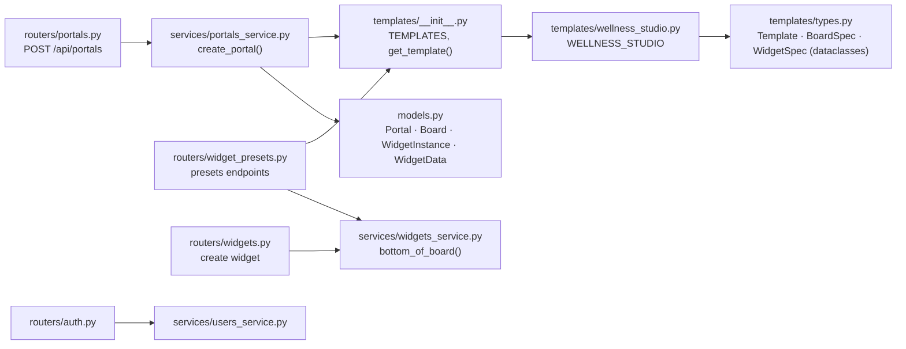

**How it does it**

A **router** handles HTTP: it reads the request, checks ownership, and returns a response or an `HTTPException`. A **service** does work that's bigger than one request or is reused elsewhere, and only knows about a `Session`. Tests call `create_portal` directly, without HTTP.

```python
# backend/app/routers/portals.py
@router.post("", status_code=status.HTTP_201_CREATED)
def create_portal(session: SessionDep, user: CurrentUserDep, data: PortalCreate) -> PortalRead:
    try:
        portal = portals_service.create_portal(session, user.id, data.name, data.template_id)
    except ValueError as error:
        raise HTTPException(status.HTTP_400_BAD_REQUEST, str(error)) from error
    return PortalRead.model_validate(portal)
```

**Templates are code, not database rows.** They're frozen dataclasses, so a template can't change at runtime:

```python
# backend/app/templates/types.py
@dataclass(frozen=True)
class WidgetSpec:
    key: str
    type: str
    description: str
    x: int
    y: int
    w: int
    h: int
    config: dict[str, Any] = field(default_factory=dict)
```

`create_portal` walks the template's boards and widgets and inserts rows for each, storing `template_key=spec.key`. Then it swaps each `source.widget` key (like `"sales"`) for the new table's real id. `wellness_studio.py` also has `generate_sample_data(today)`, which builds rows relative to today's date for tests and the planned demo.

**Start here:** a new template is a new file in `templates/`, added to the list in `templates/__init__.py`.

---

## 8. Frontend app and routing (Vite, React Router)
**Libraries:** Vite (dev server and build), React 19 with the React Compiler, React Router. **Files:** `frontend/vite.config.ts`, `frontend/index.html`, `frontend/src/main.tsx`, `frontend/src/App/**`.

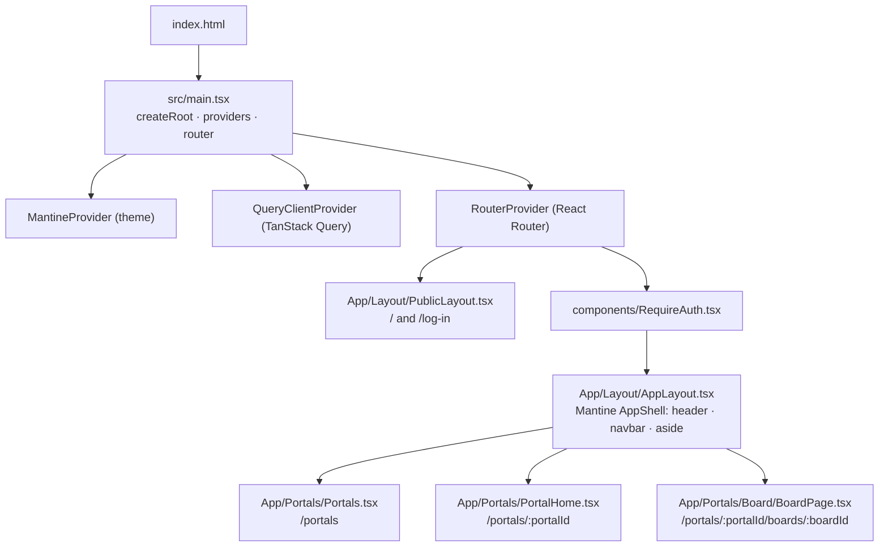

**How it does it**

`vite.config.ts` sets up React with the React Compiler (which adds memoization for you), the `@` import alias for `src/`, and a dev proxy so `/api` calls reach the backend:

```ts
// frontend/vite.config.ts
resolve: {alias: {"@": fileURLToPath(new URL("./src", import.meta.url))}},
server: {proxy: {"/api": "http://127.0.0.1:8000"}},
```

`main.tsx` wraps the app in its providers and defines every route in one place. Routes nest: a layout route renders an `<Outlet />` where its child page goes.

```tsx
// frontend/src/main.tsx
{
  element: <RequireAuth />,
  children: [
    {
      path: "portals",
      element: <AppLayout />,
      children: [
        {index: true, element: <Portals />},
        {path: ":portalId", element: <PortalHome />},
        {path: ":portalId/boards/:boardId", element: <BoardPage />},
      ],
    },
  ],
},
```

Pages read the URL's ids with `useNumberIds()` (`src/hooks/useNumberIds.ts`), which wraps React Router's `useParams` and turns them into numbers. The style guide routes only exist in development (`import.meta.env.DEV`).

**Start here:** a new page is a component under `src/App/` and a route in `main.tsx`.

---

## 9. Talking to the API (openapi-typescript, openapi-fetch, TanStack Query)
**Libraries:** openapi-typescript (generates types), openapi-fetch (the typed client), TanStack Query (fetching, caching, refreshing). **Files:** `frontend/src/api/schema.d.ts`, `frontend/src/api/client.ts`, `frontend/src/hooks/**`.

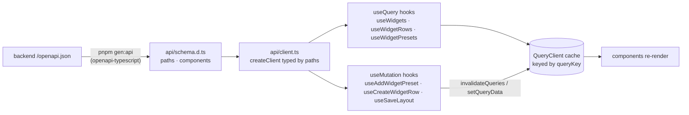

**How it does it**

*Types come from the backend.* `pnpm gen:api` reads the backend's OpenAPI spec and writes `schema.d.ts`. Hooks name types from it, so a renamed backend field becomes a TypeScript error:

```ts
export type WidgetPreset = components["schemas"]["WidgetPresetRead"]
```

*The client is typed by path.* The URL string picks the endpoint, and TypeScript then knows its parameters and its response:

```ts
// frontend/src/api/client.ts
export const api = createClient<paths>({credentials: "include"})   // sends the pb_session cookie

const {data, response} = await api.GET("/api/boards/{board_id}/widgets", {
  params: {path: {board_id: boardId}},
})
```

*Queries read and cache.* Every hook wraps one endpoint. The `queryKey` names the data in the cache; components using the same key share one request and one copy. `skipToken` waits until an id exists:

```ts
// frontend/src/hooks/widgets/useWidgets.ts
export const useWidgets = (boardId: number | undefined) =>
  useQuery({
    queryKey: ["boards", boardId, "widgets"],
    queryFn: boardId === undefined ? skipToken : async () => { ... },
  })
```

*Mutations write, then refresh.* After a change, a mutation invalidates the keys whose data changed, and every component reading them refetches:

```ts
// frontend/src/hooks/widgets/useAddWidgetPreset.ts
onSuccess: (_widget, {boardId}) =>
  queryClient.invalidateQueries({queryKey: ["boards", boardId, "widgets"]}),
```

Invalidation matches by prefix, so that key also refreshes `["boards", boardId, "widgets", "presets"]`. `useSaveLayout` goes further: it moves the widgets in the cache straight away (`setQueryData`) and puts them back if the save fails.

The keys in use:

| Key | Data |
|---|---|
| `["me"]` | the logged-in user |
| `["templates"]` | the templates a new portal can start from |
| `["portals"]` | your portals |
| `["portals", portalId, "boards"]` | a portal's boards |
| `["boards", boardId, "widgets"]` | a board's widgets |
| `["boards", boardId, "widgets", "presets"]` | presets for a board |
| `["widgets", widgetId, "data"]` | a table's rows (shared by every stat and chart that reads it) |

**Start here:** a new endpoint gets a hook in `src/hooks/`, using an existing hook of the same kind as the pattern. Run `pnpm gen:api` first.

---

## 10. UI and theme (Mantine)
**Libraries:** Mantine (`core`, `form`, `hooks`, `modals`, `notifications`, `charts` on top of Recharts, `dates`), Tabler icons, PostCSS with `postcss-preset-mantine`. **Files:** `frontend/src/theme/*`, `frontend/postcss.config.mjs`.

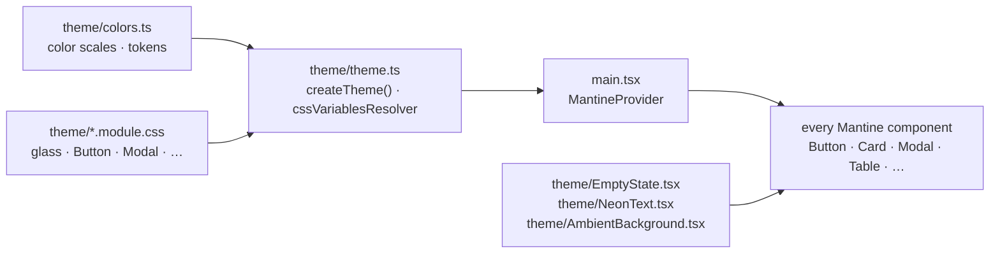

**How it does it**

`theme.ts` builds one Mantine theme. Instead of styling components in every file, it **extends** them once: default props, plus CSS module classes for the glass look:

```ts
// frontend/src/theme/theme.ts
Card: Card.extend({
  defaultProps: {padding: "lg"},
  classNames: {root: glassClasses.surface},
}),
Modal: Modal.extend({
  classNames: {
    content: `${glassClasses.glass} ${glassClasses.positioned} ${modalClasses.content}`,
    body: modalClasses.body,
    inner: modalClasses.inner,
  },
  defaultProps: {lockScroll: false, shadow: "lg", radius: "lg"},
}),
```

`cssVariablesResolver` turns the tokens in `colors.ts` into CSS variables (`--pb-cyan`, `--pb-glass`, …) with separate light and dark values, and the CSS modules use them. A `.module.css` file's class names are scoped to whatever imports it, so they can't clash.

Components use Mantine's layout props instead of CSS (`<Stack gap="xs">`, `<SimpleGrid cols={{base: 1, sm: 2, md: 3}}>`, `mt="auto"`). Forms use `@mantine/form`'s `useForm`, and toasts use `notifications.show(...)`. The style guide at `/styleguide` (dev only) shows every piece.

**Start here:** a change to how a component looks everywhere goes in `theme.ts` or a theme CSS module, not in the page.

---

## 11. Widgets (registry, react-grid-layout, aggregate)
**Libraries:** react-grid-layout (drag and resize), Mantine charts (Recharts). **Files:** `frontend/src/components/dash-boards/**`.

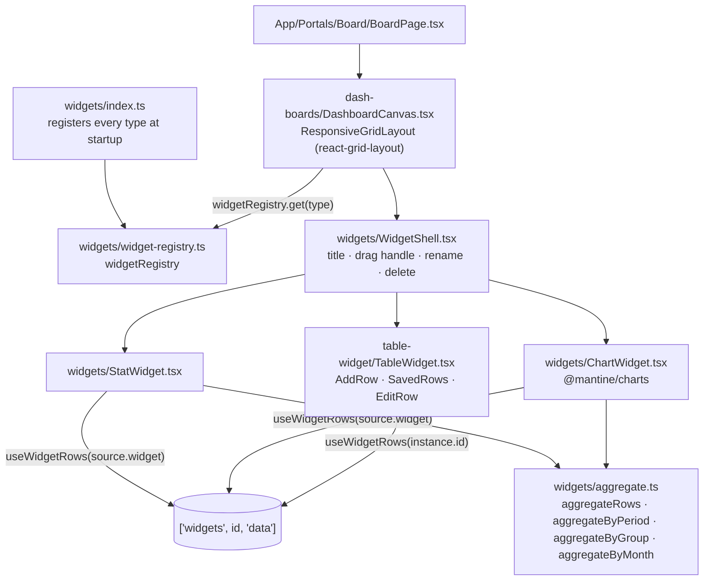

**How it does it**

*The registry maps a type to a component.* `index.ts` registers each type once (imported for its side effect at the top of `main.tsx`):

```ts
// frontend/src/components/dash-boards/widgets/index.ts
{type: "stat", kind: "output", label: "Stat", defaultSize: {w: 3, h: 2}, component: StatWidget},
{type: "table", kind: "input", label: "Table", defaultSize: {w: 12, h: 10}, component: TableWidget},
```

*The canvas lays widgets out.* `DashboardCanvas` turns each widget's `x, y, w, h` into a react-grid-layout layout on a 12-column grid with 80px rows. It looks each widget's component up by type and wraps it in `WidgetShell`. Dragging or resizing calls `useSaveLayout`.

```tsx
const definition = widgetRegistry.get(widget.type)
const Widget = definition?.component
<WidgetShell title={title} editable={editable} instance={widget}>
  {Widget ? <Widget instance={widget} /> : <Text>Unknown widget</Text>}
</WidgetShell>
```

*Stats and charts compute in the browser.* A stat stores no number. Its `config.source` says which table to read and how to sum it, and `aggregate.ts` does the math on the rows:

```tsx
// frontend/src/components/dash-boards/widgets/StatWidget.tsx
const {data: rows} = useWidgetRows(source?.widget)
const value = source && rows ? aggregateRows(rows, source) : undefined
```

The table and every stat reading it share the `["widgets", id, "data"]` cache entry, so adding a row refreshes them all at once.

**Start here:** a new widget type is a component plus one entry in `widgets/index.ts`. New math goes in `aggregate.ts`, with tests in `aggregate.test.ts`.

---

## 12. Tooling, CI and deploy
**Tools:** pnpm workspaces and `concurrently` (running both apps), uv (Python packages), Ruff (Python lint and format), ESLint and Prettier (TypeScript), pytest and Vitest (tests), GitHub Actions, Vercel. **Files:** `package.json`, `pnpm-workspace.yaml`, `backend/pyproject.toml`, `frontend/package.json`, `.github/workflows/ci.yml`, `.github/workflows/migrate.yml`, `vercel.json`.

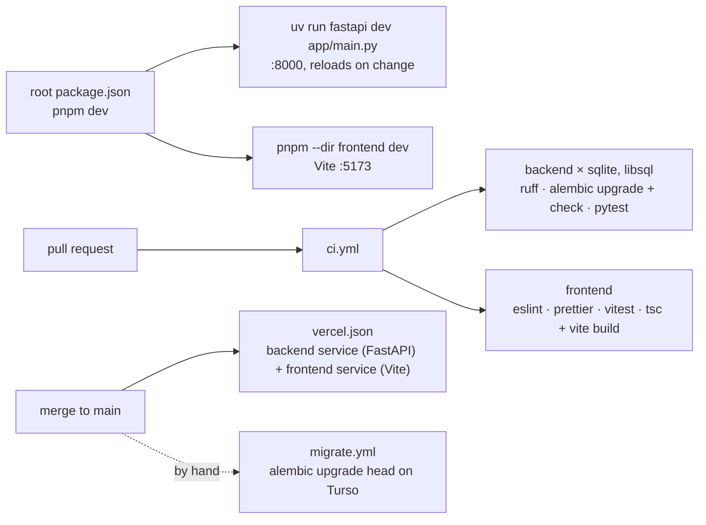

**How it does it**

The root `package.json` starts both apps with one command:

```json
"dev": "concurrently -k -n api,web -c blue,green \"uv run --directory backend fastapi dev app/main.py\" \"pnpm --dir frontend dev\""
```

`backend/pyproject.toml` lists the Python packages (installed with `uv sync`) and Ruff's rules. `frontend/package.json` lists the npm packages and the scripts CI runs (`lint`, `format:check`, `test`, `build`, `gen:api`).

`vercel.json` serves both apps from one domain. `/api/...` goes to the FastAPI service, and everything else to the Vite build, which falls back to `index.html` so React Router handles the URL:

```json
"rewrites": [
  {"source": "/api/(.*)", "destination": {"service": "backend"}},
  {"source": "/(.*)", "destination": {"service": "frontend"}}
]
```

CI runs the backend twice, once with plain SQLite and once with the libSQL driver Turso uses, so production's driver is tested on every PR.

**Start here:** a new check goes in `ci.yml`. A new environment variable goes in `config.py`, `.env.example` and Vercel's project settings.
