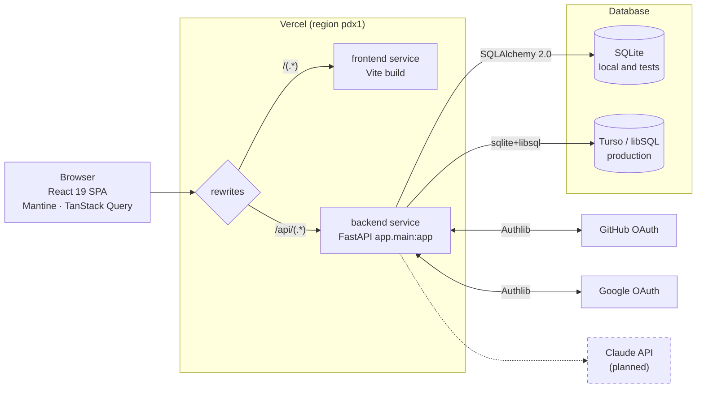
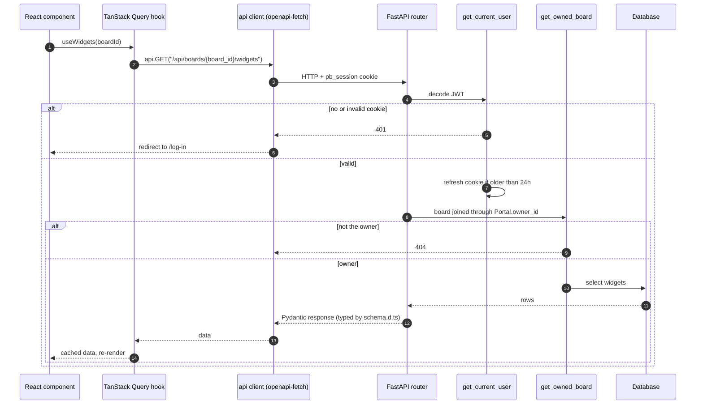
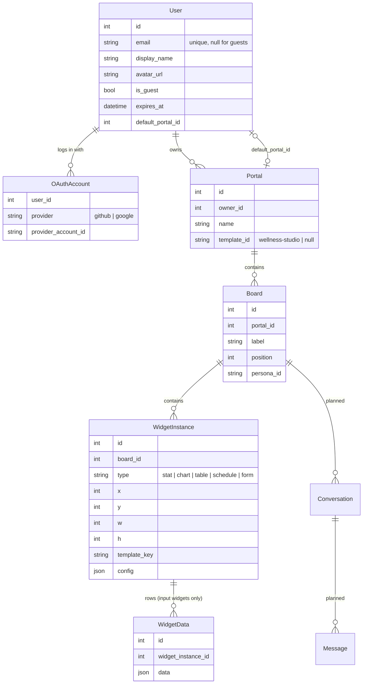
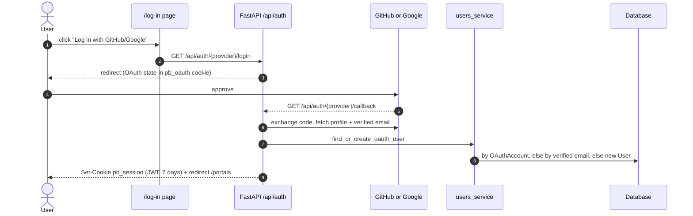
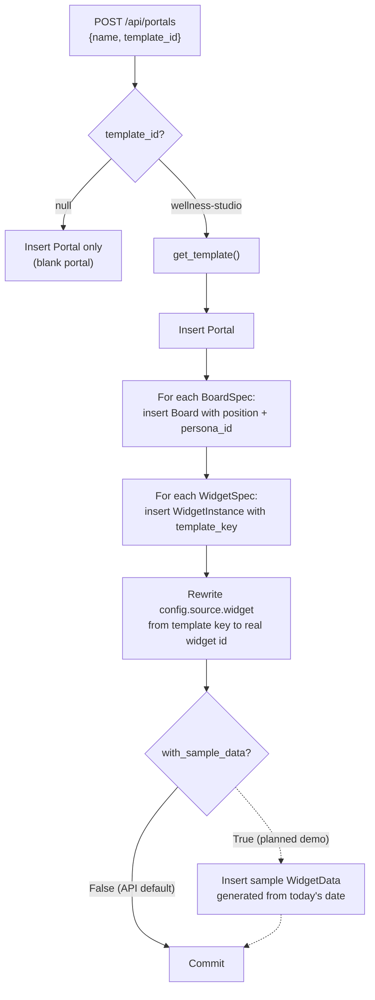
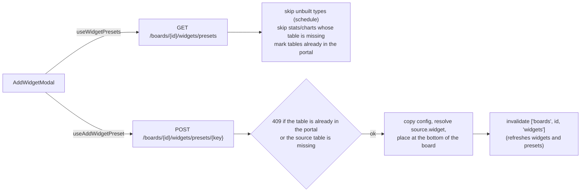
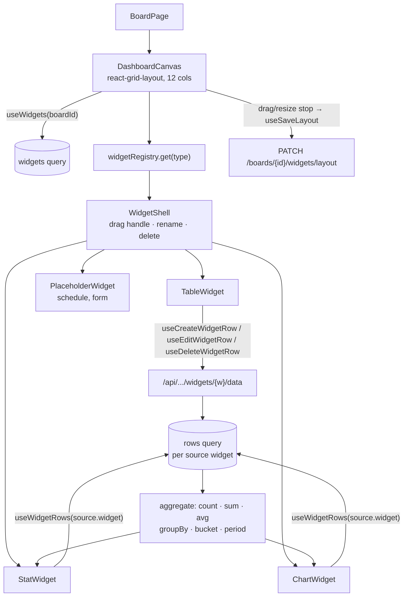
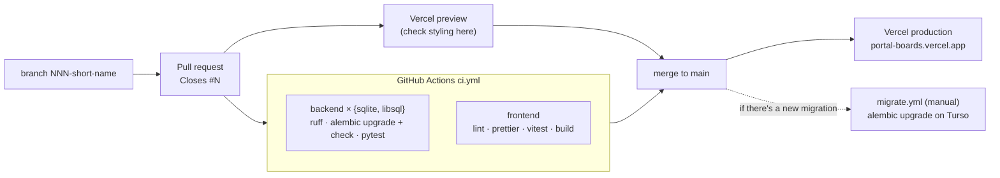

# How it works: developers

The programmer's view of portal-boards. See [PLAN.md](../PLAN.md) for the full architecture and decisions.

## 1. System architecture
One Vercel project serves two services from the same origin: the Vite SPA and the FastAPI backend. Locally, Vite proxies `/api` to `127.0.0.1:8000`.

## 2. Request lifecycle
Every call goes through the typed openapi-fetch client, which sends the `pb_session` cookie. Every query is scoped to the current user through `Portal.owner_id`, and anything the user doesn't own returns 404.

## 3. Data model
SQLAlchemy 2.0 typed models. Every foreign key below the user is `ON DELETE CASCADE`, so deleting a portal removes its boards, widgets and rows. A stat or chart's link to its table or schedule is not a foreign key: it's `source.widget` inside its JSON config. So deleting a table or schedule removes its readers in code (`get_widget_dependents`, in the same commit), and `GET /api/widgets/{id}/dependents` lists them for the delete confirmation. `Conversation` and `Message` exist for the AI assistant but aren't used yet.

## 4. Log-in
GitHub and Google OAuth through Authlib. Accounts are linked by verified email. The session is a 7-day HS256 JWT in an httponly cookie.

## 5. Creating a portal from a template
Templates live in code (`app/templates/`), not the database. `create_portal` copies one into new rows in a single transaction. After that the portal belongs to the user.

### Adding a widget from a preset
The Add widget modal lists the portal template's widgets. A table can be added once per portal, and a stat or chart only when its source table is already in the portal.

## 6. Widget rendering and live queries
Only **input** widgets (table, schedule, form) store `WidgetData` rows. **Output** widgets (stat, chart) store a `source` query in their config and compute their value in the browser, so a new row updates every stat and chart that reads it.

## 7. CI and deploy
Every PR runs CI and gets a Vercel preview. Previews share the production database and can't log in, so pages behind log-in are checked on production after merging. Migrations are run by hand.

