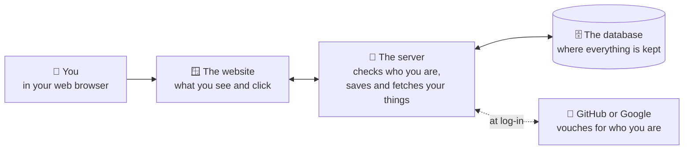
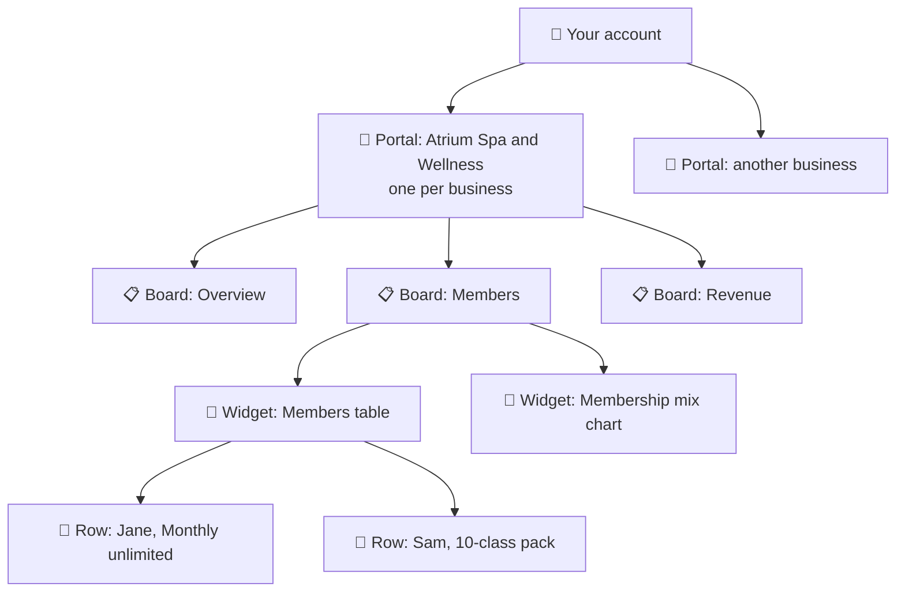
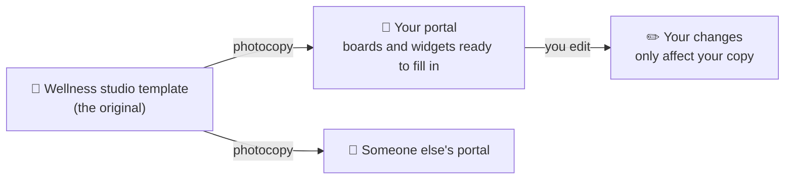
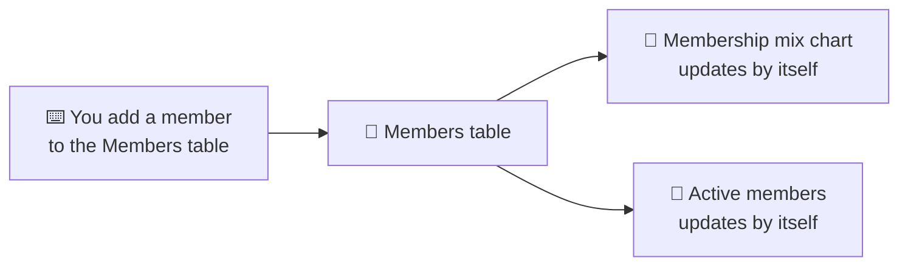

# How it works: in plain words

No code needed. This page explains what portal-boards is made of and what happens when you use it.

## 1. The big picture
The app has three parts, like a shop: a **shop window** you look at, a **clerk** who does the work, and a **filing cabinet** where everything is kept. You prove who you are with an account you already have (GitHub or Google), so the app never stores a password.

## 2. How things fit together
Everything you make sits inside something bigger, like folders inside folders.

- A **portal** is everything about one business.
- A **board** is one page of that portal.
- A **widget** is one card on a board: a table, a number, or a chart.
- A **row** is one line of information you type into a table.

## 3. Templates are photocopies
When you start a new portal you can begin blank, or from a **template** made for your kind of business. The template is **photocopied** into your portal. After that the copy is yours: change anything you like, and the original stays the same.

## 4. Tables feed the charts
You only type information into **tables**. The numbers and charts read from those tables and redraw themselves, so you never update a chart by hand.

## Coming later
- **Try it without an account:** a demo studio full of sample data, open for 24 hours.
- **An assistant on every board:** a helper with its own name and personality (studio manager, secretary, accountant) who can answer questions about your numbers.
