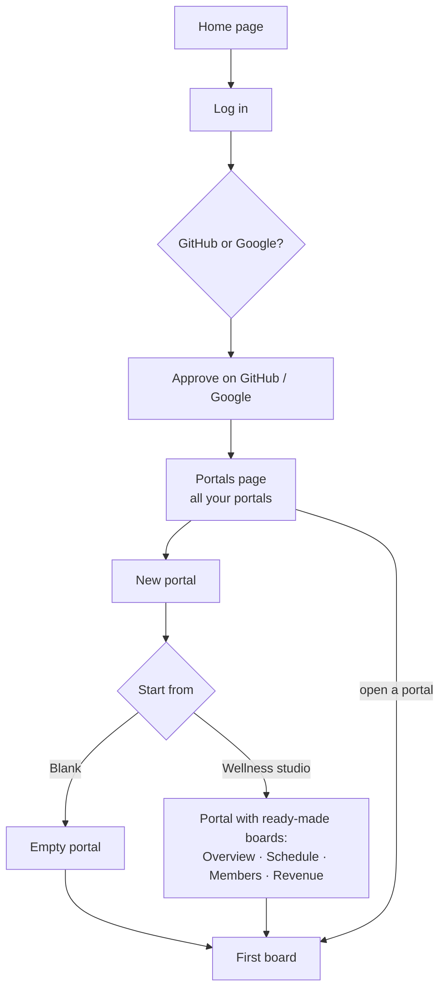
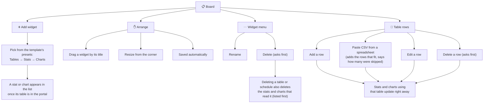
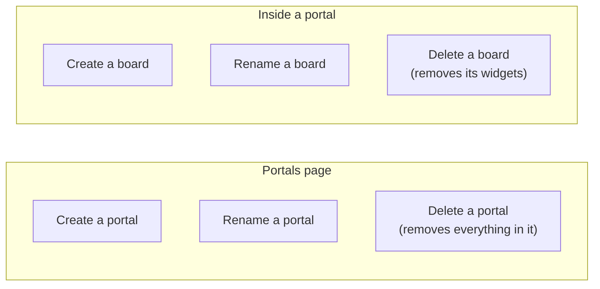
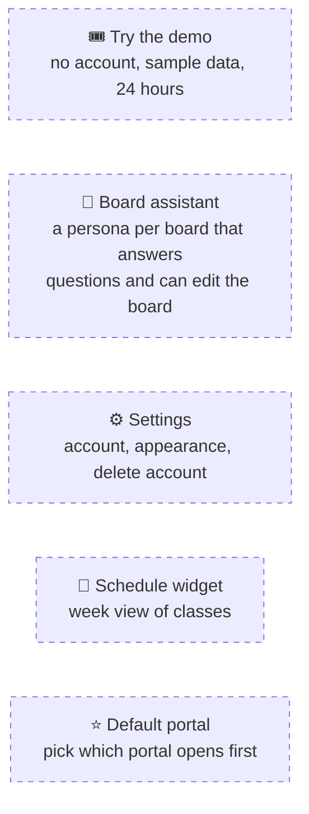

# How it works: users

What you can do in portal-boards, step by step.

## 1. Getting started
Log in with GitHub or Google, create a portal, and you land on its first board.

## 2. Working on a board
A board is a grid of widgets. Add tables first, then the stats and charts that read from them.

## 3. Organizing

## 4. Coming soon

